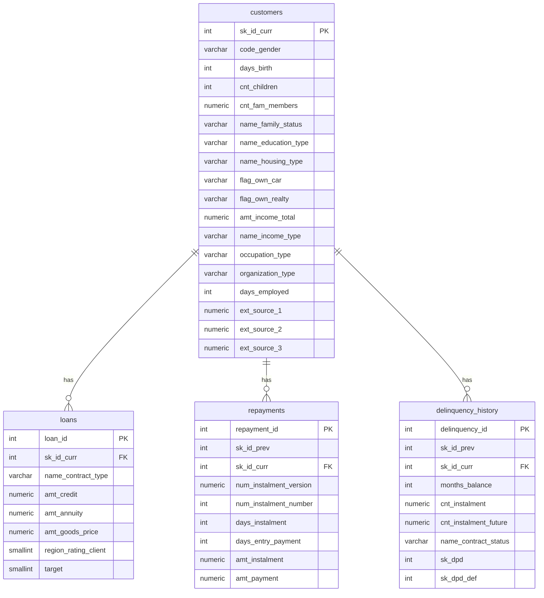
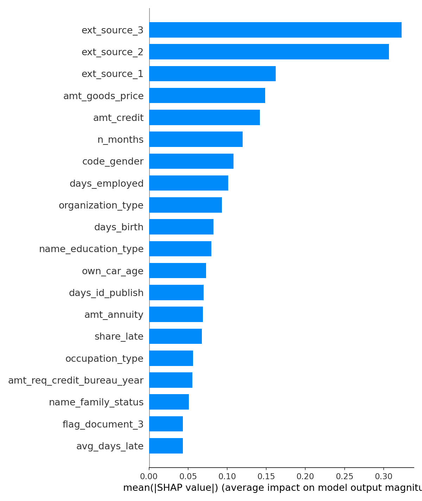
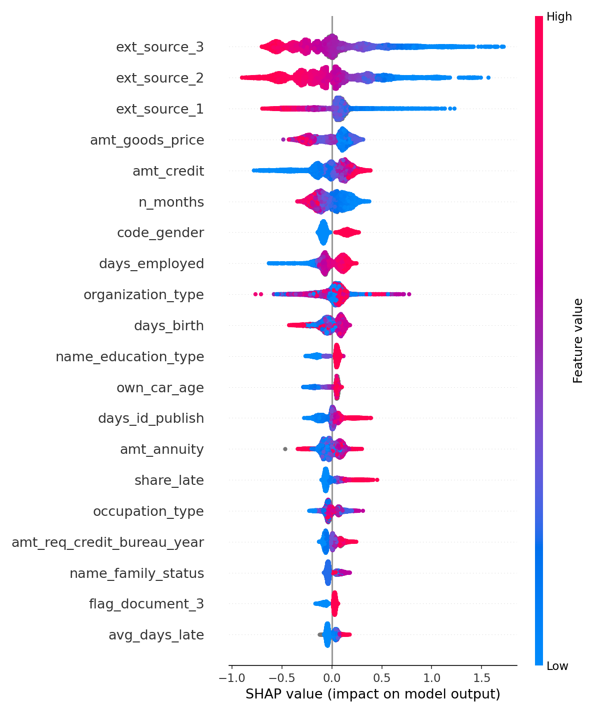
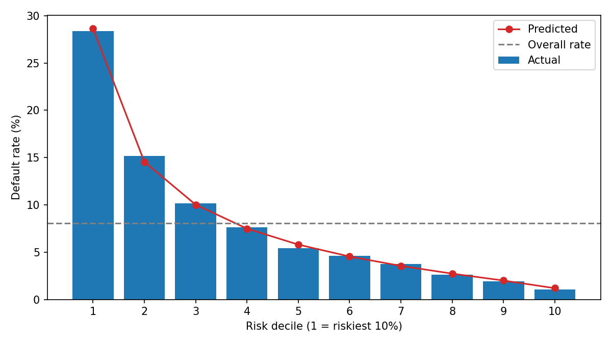

# Credit Risk and Loan Portfolio Analytics Using SQL

I built this to practice the work a bank's credit risk team does with a loan book: measure how much of it goes bad, work out which customers are riskier, and check that the data can be trusted before drawing conclusions from it. Phase 1 is done in PostgreSQL (analytics, views, indexing); Phase 2 adds a machine learning layer in Python on top of the same database.

The data is Kaggle's [Home Credit Default Risk](https://www.kaggle.com/competitions/home-credit-default-risk) data: about 307,500 loan applications, plus payment history from customers' earlier loans (about 10 million monthly status records and 13.6 million instalment records in the raw files, before keeping only customers who appear in the application data).

---

## Table of Contents

1. [Questions I Wanted to Answer](#questions-i-wanted-to-answer)
2. [The Short Version](#the-short-version)
3. [Tech Stack](#tech-stack)
4. [Project Structure](#project-structure)
5. [How to Run](#how-to-run)
6. [Database Schema](#database-schema)
7. [Phase 1: SQL Risk Analytics](#phase-1-sql-risk-analytics)
   - [Three Things I Got Wrong First](#three-things-i-got-wrong-first-and-how-i-fixed-them)
   - [Findings in Detail](#findings-in-detail)
   - [Limits of the Phase 1 Analysis](#limits-of-the-phase-1-analysis)
   - [What I Left Out on Purpose](#what-i-left-out-on-purpose)
8. [Phase 2: Machine Learning](#phase-2-machine-learning)
9. [Future Scope](#future-scope)

---

## Questions I Wanted to Answer

- What share of loans default, and what share of monthly payment records are seriously overdue (the NPL ratio)?
- Which kinds of customers (by income type, age, education) default more often?
- How does a loan's payment status change as it gets older?
- Which things I can calculate (debt-to-income, external credit scores, past lateness) actually separate risky customers from safe ones?
- Is the data clean enough to base any of this on?

---

## The Short Version

### Phase 2 headline

A tuned LightGBM trained on the full column set plus payment-history features built in SQL reaches **test AUC 0.768 and KS 0.403**. Its riskiest decile defaults at **28.4%** versus **1.0%** for the safest (27x), and the riskiest 10% of borrowers contain **35%** of all defaults. Details in the [Phase 2 section](#phase-2-machine-learning).

### Phase 1 findings

- **About 8 in 100 loans defaulted** (8.07%).
- **External credit scores are by far the strongest warning sign.** Customers whose average external score is under 0.20 defaulted 28.24% of the time. Above 0.70, only 1.98% did.
- **Debt-to-income, which I expected to matter a lot, is a weak signal on its own.** The default rate goes from 7.26% in the lowest band to about 8 to 9% in the rest, and stops rising after that.
- **Past lateness is a modest signal.** 7.72% default for customers who were never late on an earlier loan, about 10% for those who were late by 1 to 30 days.
- **Loans that stay within their scheduled term almost never become seriously overdue. The serious trouble sits in the small share of loans that run past their end date.** Inside the term, effectively 0% of monthly records are 90+ days overdue. Past the term, 27.85% are.
- **When a loan is going to slip, it usually slips early.** The share of late loans climbs during the first 10 months of a loan's life, then stays flat.

---

## Tech Stack

- **PostgreSQL**: schema, all analytical queries, views, a materialized view, indexing, constraints
- **Python (pandas, SQLAlchemy)**: bulk load of the CSVs into staging tables
- **Python (scikit-learn, LightGBM, XGBoost, SHAP)**: Phase 2 modeling and explainability
- **pgAdmin 4 and Jupyter**: running queries and notebooks

---

## Project Structure

```
credit_risk_sql_project/
├── 01_schema/                 # Table definitions, CHECK constraints
├── 02_data_load/              # Staging load script, column screening, INSERT statements
├── 03_risk_analysis/
│   ├── 01_portfolio_overview_and_npl.sql
│   ├── 02_segmentation_analysis.sql
│   ├── 03_roll_rate_analysis.sql
│   ├── 04_risk_signal_validation.sql
│   ├── 05_data_quality_checks.sql
│   ├── 06_vintage_analysis.sql
│   ├── 07_risk_driver_calibration.sql
│   └── 08_ntile_deciles.sql
├── 04_views/                  # Reusable views + materialized payment-feature view
├── 05_performance/            # Indexing + EXPLAIN ANALYZE test
├── 06_ml_phase/               # Notebook, results log, decile table, SHAP and decile plots
└── README.md
```

---

## How to Run

1. Create a PostgreSQL database (for example `home_credit`).
2. Run `01_schema/01_create_tables.sql`.
3. Download `application_train.csv`, `installments_payments.csv` and `POS_CASH_balance.csv` from the Kaggle competition page (you have to accept the competition terms first).
4. Edit `CSV_DIR` in `02_data_load/00_load_staging_tables.py` and run it. (Optionally run `column_screening.py` in the same folder afterwards.) The connection string assumes a local install with no password (`postgres@localhost:5432/home_credit`), so change it if yours differs.
5. Run `02_data_load/01_load_customers_and_loans.sql`, then `02_load_repayments.sql`, then `03_load_delinquency_history.sql`. The repayments load is slow.
6. Run any of the queries in `03_risk_analysis/`. They only read data. The vintage queries scan the whole delinquency table, so give them a minute.
7. Run `04_views/01_create_views.sql` to create the reporting views.
8. Optionally run `05_performance/01_indexing_and_explain_analyze.sql` to reproduce the indexing test.
9. Run `01_schema/02_check_constraints.sql` (sanity check first; all counts should be 0), `03_risk_analysis/08_ntile_deciles.sql`, and `04_views/02_materialized_payment_features.sql` (builds the feature view; takes a few minutes).
10. Phase 2: install `lightgbm xgboost shap`, then run `06_ml_phase/credit_risk_ml.ipynb`. Parts 1 and 2 run in order; Parts 3 onward are self-contained. The first Part 1 cell computes Information Value on the full dataset; the second recomputes it on train rows only to check for leakage (it is self-contained and can be run alone).

---

## Database Schema

The diagram shows the main columns; the full list is in the data dictionary below.



### Constraints

`CHECK` constraints (`01_schema/02_check_constraints.sql`) enforce: `target` in {0,1}, positive credit amount and income, negative `days_birth`, external scores between 0 and 1, and non-negative days past due. All existing rows passed before the constraints were added.

### Data Dictionary

#### `customers`

One row per applicant (demographics, income, employment, external scores).

| Column | Description |
|---|---|
| `sk_id_curr` | Unique customer/application ID (Primary Key) |
| `code_gender` | Borrower's gender |
| `days_birth` | Age in negative days from application date |
| `cnt_children` / `cnt_fam_members` | Family size |
| `name_family_status` / `name_education_type` / `name_housing_type` | Demographics |
| `flag_own_car` / `flag_own_realty` | Asset ownership flags |
| `amt_income_total` / `name_income_type` | Income level and category |
| `occupation_type` / `organization_type` | Job role / employer industry |
| `days_employed` | Employment duration (contains a placeholder value, see [Data quality](#data-quality)) |
| `ext_source_1/2/3` | Three anonymised external credit scores, 0 to 1, higher is safer |
| `def_30/60_cnt_social_circle`, `obs_30/60_cnt_social_circle` | Defaults among the borrower's social circle |
| `amt_req_credit_bureau_*` | Recent credit bureau inquiry counts |
| `region_population_relative` | Regional population density proxy |
| `days_last_phone_change` | Days since last phone number change |
| `reg_city_not_live_city/work_city` | Address mismatch flags |

#### `loans`

One row per loan application (terms and outcome).

| Column | Description |
|---|---|
| `loan_id` | Primary Key |
| `sk_id_curr` | Foreign Key to `customers` |
| `name_contract_type` | Cash loan or revolving credit |
| `amt_credit` | Loan amount (exposure) |
| `amt_annuity` | Instalment/EMI amount |
| `amt_goods_price` | Price of financed goods |
| `region_rating_client` | Regional risk rating |
| `target` | **1 = defaulted, 0 = repaid** |

#### `repayments`

One row per instalment payment event, on earlier loans.

| Column | Description |
|---|---|
| `sk_id_prev` | ID of the earlier loan |
| `days_instalment` / `days_entry_payment` | Due date vs. actual payment date (the difference is days late) |
| `amt_instalment` / `amt_payment` | Amount due vs. amount actually paid |

#### `delinquency_history`

One row per earlier loan, per month (status snapshot).

| Column | Description |
|---|---|
| `sk_id_prev` | ID of the earlier loan |
| `months_balance` | Month of the snapshot, counted back from the application date (0 = now, -1 = last month) |
| `cnt_instalment` | Scheduled number of instalments (the loan's term) |
| `sk_dpd` | **Days past due**, the core metric for DPD buckets and NPL |
| `sk_dpd_def` | Stricter DPD variant (ignores small tolerable overdue amounts) |

### Column Selection

Of the 122 columns in the source `application_train.csv`, I kept 30 using a domain-relevance filter: does this column plausibly affect a borrower's ability or willingness to repay? Dropped columns were mostly building and apartment quality measures (about 50 columns), document-submission flags (20), and weak contact and address flags. `02_data_load/column_screening.py` lists every numeric column's missing rate and its correlation with `target`; the building-quality and document-flag columns I dropped all sit below 0.05 in absolute correlation. That is a plain linear check, so it can't rule out a subtler relationship. What's left maps to concrete credit risk ideas: income and job stability, demographic stability, external scores, default exposure in the social circle, and how often the customer has been shopping for credit.

> **Note for Phase 2:** the ML phase reads `staging_application_train` (all 122 columns), not the 30-column `customers`/`loans` schema, because the Information Value screening ran on the raw table, and some selected columns, such as `flag_document_3`, are not in the clean schema.

---

## Phase 1: SQL Risk Analytics

### Three Things I Got Wrong First, and How I Fixed Them

Each of these changed a result, so I'm leaving the story in instead of showing only the clean final numbers. The ML phase has its own list in the [Phase 2 section](#things-i-got-wrong-or-caught-in-the-ml-phase).

**1. My first roll-rate analysis counted the same loan many times.**
I started by counting every month-to-month change in days past due. That is misleading: a loan that bounces between late and on time gets counted again and again, so the portfolio looks like it is deteriorating more than it really is. I noticed this before building on it and changed the approach to compare each loan's first and last recorded status, giving one outcome per loan (Ended Worse, Ended Better, No Net Change).

**2. My first indexing comparison was not a fair test.**
I had compared the timing of two different queries, one before an index existed and one after, which says nothing about the index itself. I redid it as a controlled test: the same query with the index, without it, then with it again. A lookup of one customer went from 63.11 ms to 0.09 ms (about 700x faster). A full-table aggregate went from 299 ms to 284 ms, barely any change. Indexes help when you look up a few rows, and do very little when a query has to read most of the table.

**3. The first loan-age curve had jumps that weren't real.**
The share of late loans leapt at loan ages 13, 25 and 37, and then sat near 30% past month 36. The jumps land on multiples of 12, and the number of loan records drops at the same points (230,107 at age 12 down to 141,797 at age 13). The explanation is survivor bias. Healthy loans on 12, 24 and 36 month terms finish and leave the data, while the loans still being recorded after their scheduled end are mostly the ones that weren't paid. The denominator shrinks, so the late share jumps even though no individual loan changed. The fix was to count records only up to each loan's scheduled term. With that, the jumps disappear. The loans that run past their term turned out to be a finding of their own (see [Loan age analysis](#loan-age-vintage-analysis)).

### Findings in Detail

#### Portfolio Overview

307,511 loans, 24,825 defaults, so an 8.07% default rate. Looking at monthly payment records on earlier loans, 1.23% were more than 90 days past due (the NPL ratio). Records are also split into DPD buckets: current, 1-30, 31-60, 61-90 and 90+ days (`03_risk_analysis/01_portfolio_overview_and_npl.sql`).

#### Data Quality

I checked the data before using it.

- `days_employed` has a placeholder value (365243) instead of a real number for **18.01%** of customers. I flagged it instead of using it, because it would badly distort anything about employment length.
- No duplicate customer IDs, and no missing or non-positive income values.
- The three external scores are patchy: `ext_source_2` is missing for only 0.21% of customers, `ext_source_3` for 19.83%, and `ext_source_1` for **56.38%**. That is why I used `ext_source_2` for the single-score check, and why the later analysis averages whichever scores a customer has.
- 289,444 customers (94.12%) have earlier loans on record. The other 5.88% have no history, and turned out to be the safest group (see below), so "no history" is not a red flag here.

#### What Separates Risky Customers from Safe Ones

The bands below are cut points I chose myself. Overall default rate is 8.07%.

**Average external score** (average of whichever of the three scores a customer has):

| Average external score | Customers | Default rate |
|---|---|---|
| Under 0.20 | 10,448 | 28.24% |
| 0.20 to 0.30 | 19,231 | 20.36% |
| 0.30 to 0.40 | 39,719 | 14.08% |
| 0.40 to 0.50 | 65,387 | 8.52% |
| 0.50 to 0.60 | 78,336 | 5.14% |
| 0.60 to 0.70 | 67,520 | 3.29% |
| 0.70 and above | 26,698 | 1.98% |
| No score at all | 172 | 8.14% |

The default rate falls at every step, about a 14x difference between the top and bottom bands. This is the clearest signal in the project.

An `NTILE(10)` version on `ext_source_2` alone (equal-sized groups of about 30,685 customers) shows the same shape: 18.35% default in the lowest-score decile down to 2.97% in the highest, a 6x spread from one feature (`03_risk_analysis/08_ntile_deciles.sql`).

**Debt-to-income** (annuity divided by income):

| DTI | Customers | Default rate |
|---|---|---|
| Under 0.10 | 54,268 | 7.26% |
| 0.10 to 0.20 | 147,867 | 8.01% |
| 0.20 to 0.30 | 73,936 | 8.76% |
| 0.30 to 0.40 | 23,492 | 8.11% |
| 0.40 and above | 7,936 | 8.27% |

The whole spread is about 1.5 percentage points, and it stops rising after 0.30. The 12 customers with no DTI show 0.00%, which is too few people to read anything into.

**Worst delay on earlier loans:**

| History | Customers | Default rate |
|---|---|---|
| No earlier loans | 18,067 | 6.66% |
| Never late | 234,761 | 7.72% |
| Worst delay 1 to 30 days | 47,509 | 10.13% |
| Worst delay 31 to 90 days | 2,532 | 11.41% |
| Worst delay over 90 days | 4,642 | 8.51% |

Having been late at all is worth about 2 to 3 points. The top group doesn't keep climbing, and its size (a few thousand customers) makes the rate noisy. I haven't checked why.

#### Segmentation

Default rates differ across income type, age group and education level (`02_segmentation_analysis.sql`). Combining income type with education and ranking the groups (`RANK()`, groups over 100 loans only) picks out specific high-risk combinations that looking at one factor at a time would miss.

#### Loan Trajectory (Roll-Rate)

Each loan is classified by comparing its first and last recorded days past due with `FIRST_VALUE` and `LAST_VALUE`: Ended Worse, Ended Better, or No Net Change. See [Three things I got wrong first](#three-things-i-got-wrong-first-and-how-i-fixed-them) for why it works this way.

#### Loan Age (Vintage) Analysis

The plain-language question: how risky is a loan at month 3, month 6, month 12 of its life?

The payment data has no start date, only a month number counted back from the application date, so a loan's age is its month minus its own first recorded month. Of 800,337 earlier loans, I dropped 29,896 whose history is cut off at the start of the 96-month window (their real start is unknown) and 1,634 with missing months. I kept the ~81,600 loans still running at the end of the window, since each age gets its own denominator.

What it shows, after the fix described above:

- A loan starts clean (0.04% late at age 0), and the late share rises to about 3% by month 10.
- After that it stays roughly flat, about 2 to 2.9%, all the way to age 35.
- Being 30 or more days late stays around 0.05 to 0.1% throughout.

Then I split every record into **in term** (at or before the loan's scheduled end) and **past term** (after it, still open):

| | Records | Loans | Any lateness | 90+ days overdue |
|---|---|---|---|---|
| In term | 8,048,269 | 768,053 | 1.71% | 0.00% |
| Past term | 198,411 | 60,596 | 31.64% | 27.85% |

Past-term records are about 2.4% of all records, and about 7.9% of loans have at least one of them, but they carry nearly all of the seriously overdue records. This is consistent with the 1.23% NPL ratio being driven mostly by loans that overrun their term. I haven't proven that, since the NPL figure covers the whole table and this split only covers the loans with clean histories.

#### Performance and Indexing

Covered above. The takeaway: an index turned a one-customer lookup from 63.11 ms into 0.09 ms, and did almost nothing for a full-table aggregate (299 ms to 284 ms).

### Limits of the Phase 1 Analysis

- **The external scores are third-party and anonymised.** The dataset doesn't say where they come from, so anything built on them inherits that opacity.
- **The vintage and lateness data are about earlier loans**, not the loan behind `target`. The vintage curve describes how earlier loans behaved. The lateness table uses earlier loans to look at current default.
- **Phase 1 is descriptive, on the full dataset.** There is no train/test split, and the bands are my own cut points. It shows where risk sits; prediction is Phase 2.
- **The tail of the vintage curve is thin.** Past about age 35 there are under 3,000 records per age, and the numbers get noisy.
- **The in-term boundary can be off by one month.** Whether a loan's last scheduled instalment falls at age `term` or `term - 1` depends on how the source numbers months. It doesn't change the finding.
- **I don't know why loans overrun their term.** It could be genuine non-payment or a quirk in how terms are recorded, so I describe the delinquency as "concentrated in" those loans, not "caused by" them.
- **The `repayments` table is not analysed in Phase 1.** It holds 11.6 million instalment records and is used in Phase 2 to build payment-behaviour features (`04_views/02_materialized_payment_features.sql`).

### What I Left Out on Purpose

**A hand-built composite risk score.** I started designing a points-based score from the three drivers above, then stopped. Weights I pick by hand are just my opinion, and the three drivers overlap, so adding their points counts some information twice. A regression estimates all the weights together and adjusts for that overlap, so it belongs in Phase 2. What I kept from that work is the driver tables above. In Phase 2 a model estimates the weights from data instead.

**Added later:** `NTILE()` deciles, a materialized view for the payment-history features (the delinquency table has millions of rows) and `CHECK` constraints for schema-level validation.

**Still skipped:** a star-schema redesign and table partitioning; reasonable extensions, not needed for the questions here.

---

## Phase 2: Machine Learning

A model layer on the same database: SQL-built payment-history features, a logistic regression scorecard, LightGBM and XGBoost, SHAP explanations and decile validation. Everything below is evaluated on one held-out test set (61,503 loans).

### Headline ML Results

| Metric (held-out test set, 61,503 loans) | Value |
|---|---|
| Best model | Tuned LightGBM |
| Test AUC / Gini / KS | 0.768 / 0.535 / 0.403 |
| Riskiest decile default rate | 28.4% |
| Safest decile default rate | 1.0% (27x spread) |
| Defaults captured in riskiest 10% / 30% of borrowers | 35% / 67% |
| Predicted vs actual default rate per decile | within ~1 percentage point |

### Features

**SQL payment-history features** (materialized view `mv_customer_payment_features`, one row per customer): installment count, average/max days late, share of late and underpaid installments (from `repayments`); months on record, max DPD, share of months with DPD (from `delinquency_history`); plus "no history" flags. About 5-6% of customers have no history. Computed once as a materialized view because it scans ~21M rows.

**Two feature strategies:**

- *Logistic scorecard:* I ranked all 122 raw columns by Information Value (IV) and picked 19 features from the ranking, which expand to 120 inputs after encoding. IV was a guide, not a strict cutoff, and the list does not follow a clean "IV >= 0.02" rule. Three of the 19 sit just under 0.02 (`amt_req_credit_bureau_year` 0.017, `name_housing_type` 0.015, `def_30_cnt_social_circle` 0.014); I kept them because bureau inquiries, social-circle defaults and housing type are plausible risk factors. And 40 columns that clear 0.02 on the train rows were left out: 31 are the building/apartment family (average, median and mode copies of the same attribute, 48 to 70% missing), and 9 are not. Of those nine, `region_rating_client_w_city` is a near-duplicate of `region_rating_client`, `amt_annuity` moves with `amt_credit`, and `own_car_age` is 66% missing. The other six (`days_id_publish`, `region_population_relative`, `reg_city_not_work_city`, `reg_city_not_live_city`, `flag_emp_phone`, `days_registration`) I left out without a rule I can point to. The all-columns logistic row below includes all of them and gains about 0.004 AUC, though that run also differs in other ways, so treat that as a rough size, not a clean measurement.
- *Tree models:* all raw columns plus payment features (130 inputs), raw NaN, native categoricals. IV is a filter for linear models; trees handle redundancy and missing values themselves.

### Evaluation Setup

Stratified 80/20 split (`random_state=42`), both sets at 8.07% default. Imputation and scaling fitted on train only. Tree early stopping used a validation slice carved from train; tuning used 5-fold CV on train only. Metrics are AUC, Gini and KS (ranking metrics), not accuracy: predicting "no default" for everyone is already 92% accurate.

### Results (Same Split for Every Model)

| Model | Test AUC | Gini | KS |
|---|---|---|---|
| Logistic, 19 IV-selected features | 0.7460 | 0.4921 | 0.3678 |
| Logistic, 19 features + credit/goods ratio | 0.7462 | 0.4923 | 0.3669 |
| Logistic, 19 features + payment history | 0.7516 | 0.5032 | 0.3754 |
| Logistic, all columns + payment history | 0.7558 | 0.5115 | 0.3843 |
| LightGBM, untuned | 0.7678 | 0.5355 | 0.3982 |
| XGBoost, untuned | 0.7664 | 0.5328 | 0.3987 |
| **LightGBM, tuned (5-fold CV)** | **0.7677** | **0.5354** | **0.4034** |

**What drove the gains**

- Payment features added +0.005 AUC to logistic regression, less than I expected. A linear model cannot use thresholds, and lifetime averages are crude.
- Of the +0.016 AUC between the 19-feature logistic with payment history (0.7516) and untuned LightGBM (0.7678), about three quarters came from the model type and one quarter from the wider feature set.
- The IV filter held up: the 19-feature logistic lost only ~0.004 AUC versus all columns, and the all-columns run uses no IV at all.
- LightGBM vs XGBoost is a tie (AUC differs by 0.0014, well inside ~±0.004 sampling noise). LightGBM was chosen because it trained ~2.6x faster, overfit slightly less, and reads categoricals natively.
- Tuning did not improve AUC. I ran two small searches, an 8-config grid and an 11-config random search, both scored with 5-fold CV on train. The best CV AUC was about 0.7659 against 0.7650 for the original settings, well inside the fold-to-fold noise (about ±0.005). It did shrink the train/test gap from 0.077 to 0.053, so I kept the regularized model. Both searches were small and hand-picked, not exhaustive.

### Things I Got Wrong or Caught in the ML Phase

**Multicollinearity, caught from coefficients.**
The first logistic model gave `amt_credit` +0.93 and `amt_goods_price` -0.92. They are near-duplicates (r = 0.987), so the model split credit between them with opposite signs. I replaced both with a credit/goods ratio. Performance was unchanged, but the coefficients became interpretable. The same pair shows up in the SHAP plot, so treat them as one "credit relative to goods price" effect.

**An early-stopping bug.**
My first LightGBM run stopped after 1 tree (AUC 0.715). I had set a class-imbalance weight, which distorted the log-loss that early stopping was also watching. I switched early stopping to AUC only, dropped the weight (AUC and KS only measure ranking), and the model trained properly (797 trees, AUC 0.768).

**The feature list wasn't the clean rule I first described, and IV leaked a little.**
I first described the 19 features as "IV >= 0.02, minus the building family". Re-running IV on train rows only, to check for leakage, showed two things. The leakage was tiny: no IV moved by more than 0.0035. But the description was too tidy: three kept features are under 0.02, and nine non-building columns above 0.02 were left out. Details are in the [Features](#features) section above.

### Explainability (SHAP, 10,000-Row Test Sample)




- The three external credit scores are the top drivers (higher score lowers risk), consistent with Phase 1.
- SQL-derived payment features (`n_months`, `share_late`) rank in the top 15.
- `organization_type` ranked 3rd by gain in both LightGBM and XGBoost but 9th by SHAP, consistent with gain's bias toward high-cardinality columns (about 58 categories). I first compared gain importances of different types across libraries, caught the mismatch, recomputed with total gain for both, and confirmed the metrics reproduced exactly. After the fix, the two libraries' rankings agreed (Spearman 0.98); SHAP and gain agreed overall at 0.95.
- A permutation-importance check (AUC drop when a column is shuffled, untuned model) ranked `organization_type` 14th, the same direction as SHAP. Ranks that are close together can swap on a different sample; quote the top group, not exact positions.

### Decile Validation



| Decile | Actual default rate | Predicted | Cumulative defaults captured |
|---|---|---|---|
| 1 (riskiest 10%) | 28.4% | 28.6% | 35.1% |
| 2 | 15.2% | 14.6% | 54.0% |
| 3 | 10.2% | 10.0% | 66.6% |
| 5 | 5.4% | 5.8% | 82.7% |
| 10 (safest 10%) | 1.0% | 1.2% | 100% |

Default rates fall at every step, and predicted probabilities track actual rates closely. This LightGBM was trained without class weighting. (The class-weighted logistic regression ranks well but its probabilities are inflated and not calibrated.) Calibration was checked in 10 coarse buckets on the test set only. A fuller check on the untuned LightGBM gave average predicted risk 8.00% vs actual 8.07%, calibration slope 1.011 and intercept 0.033, and Brier score 0.0670 vs 0.0742 for always predicting the base rate; Platt scaling and isotonic regression did not improve it, so no recalibration was applied. It was not re-run on the tuned model.

### Limits of the ML Phase

- **Staging table:** Phase 2 reads from `staging_application_train` (all 122 columns), not the cleaned schema, because the schema dropped some columns (e.g. `flag_document_3`).
- **IV leakage (checked):** I first computed Information Value on all 307,511 rows, including the rows later used as the test set, so the test set could have influenced which features were kept. I re-ran it on train rows only. No IV moved by more than 0.0035 (the largest was `ext_source_3`, 0.3293 on all rows vs 0.3258 on train), and none of the 19 selected features changed side of the 0.02 line. So the leakage did not change the selection. The looser-than-advertised selection rule (see [Features](#features)) is the bigger caveat. The tree models never used the 19-feature list.
- **Gender:** `code_gender` ranks 7th by SHAP. In production lending it would be excluded for fair-lending reasons, and the model would need re-checking without it. I did not measure the AUC cost of removing it.
- **Comparison is approximately controlled:** model settings are comparable, not identical, across logistic, LightGBM and XGBoost; the logistic all-columns run also used regularization and the credit/goods ratio.
- **No profit claims:** the dataset has no margins or loss-given-default, so decile results describe ranking quality, not profitability.
- **Saved results:** the notebook is stored without outputs, and `results_log.csv` and `decile_table.csv` were copied from the numbers printed when I ran it, not exported by code. Every model uses `random_state=42`, so re-running should reproduce them closely, though tree-model scores can differ in the last digit or two across library versions or machines.
- **Not used:** the `bureau`, `previous_application` and `credit_card_balance` tables. Published solutions that use them reach higher AUC; adding them is the main next step, along with recent-window (6/12-month) payment features.

---

## Future Scope

> Nothing in this section exists yet. It is what I would build next.

### 1. A Prediction API

Wrap the final LightGBM model in a small REST service (FastAPI) so another program can send an applicant's details and get back a default probability and a risk decile (1 = riskiest 10%). Because the tuned model was trained without class weighting, its probabilities track real default rates (see the decile table), so the API can return the probability itself, not just a rank. Planned pieces: the saved model file, input validation, a short explanation with each prediction (the top few SHAP drivers), and a Docker image so it runs the same way anywhere.

One design problem to solve first: the model takes 130 inputs, and ten of them are payment-history features I built in SQL from a customer's earlier loans. The API either has to ask the caller for those or look them up in the database by customer ID. The categorical columns also have to use exactly the category levels the model was trained on.

### 2. A Live Demo Site

A simple web page on top of the API: someone enters a few applicant details and sees the risk score, which decile it falls in, and the main reasons behind it. It would be deployed on a free cloud tier so the link works from this README. I would state three things on the page: it is a demo trained on a public dataset with anonymised external scores, it is not something to use for a real lending decision, and a free tier can be slow to wake up after sitting idle. I would also deal with `code_gender` before going live, either by dropping it and measuring the AUC cost (not measured yet, see Limits) or at least by not asking for it on the site.

### 3. Model Improvements

Improving the model itself (the bureau tables and recent-window payment features under Limits) is separate from serving it, and could happen before or after.
